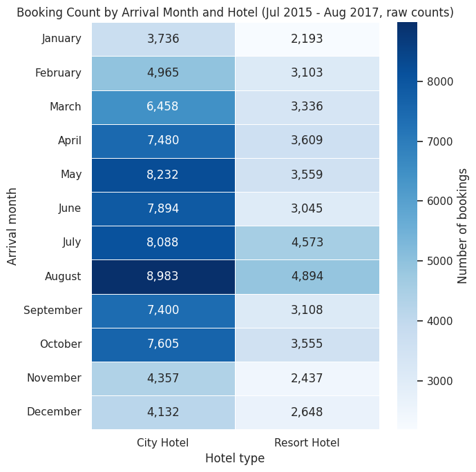
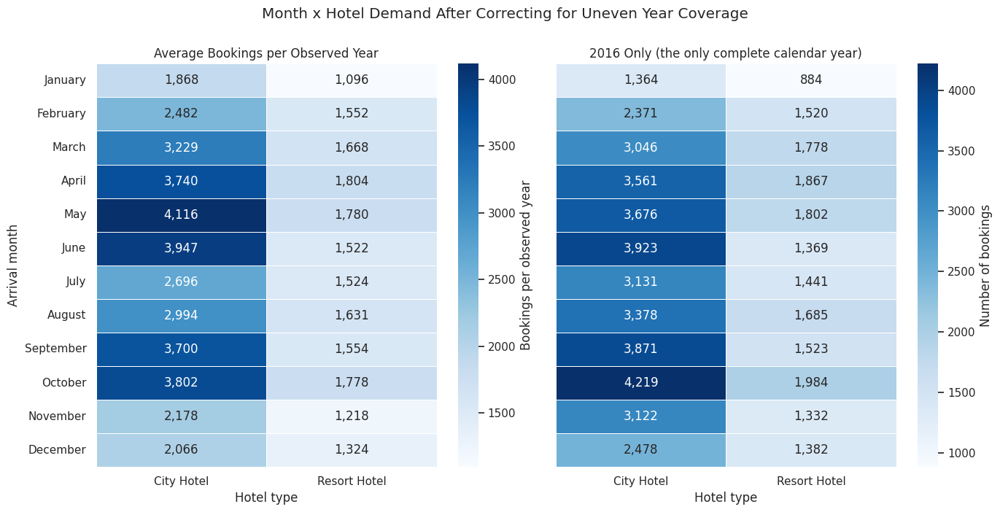
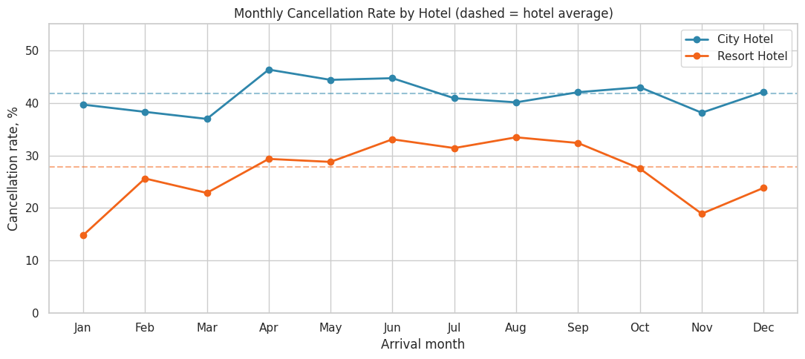
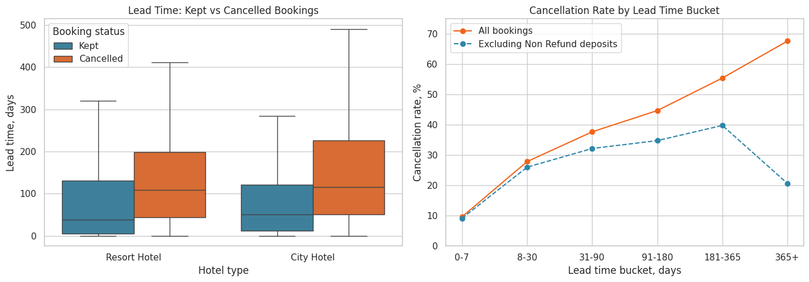
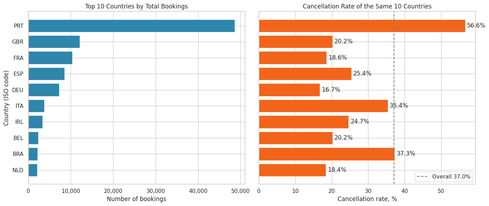
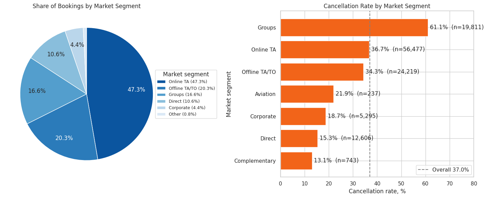
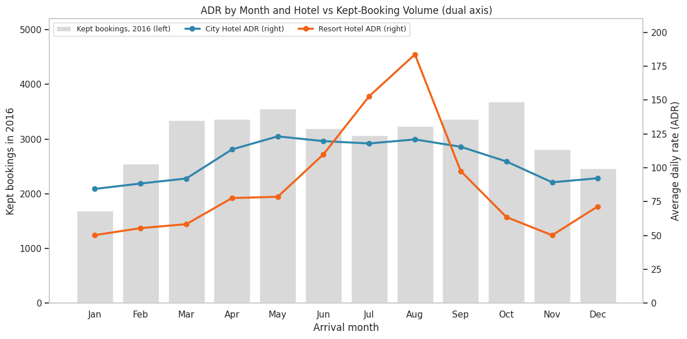
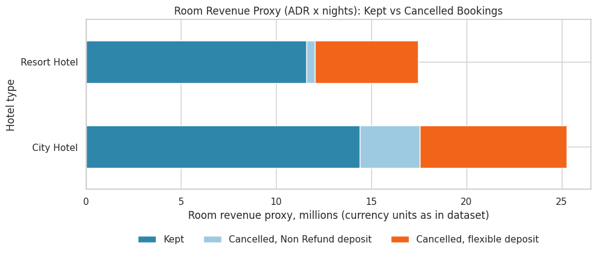
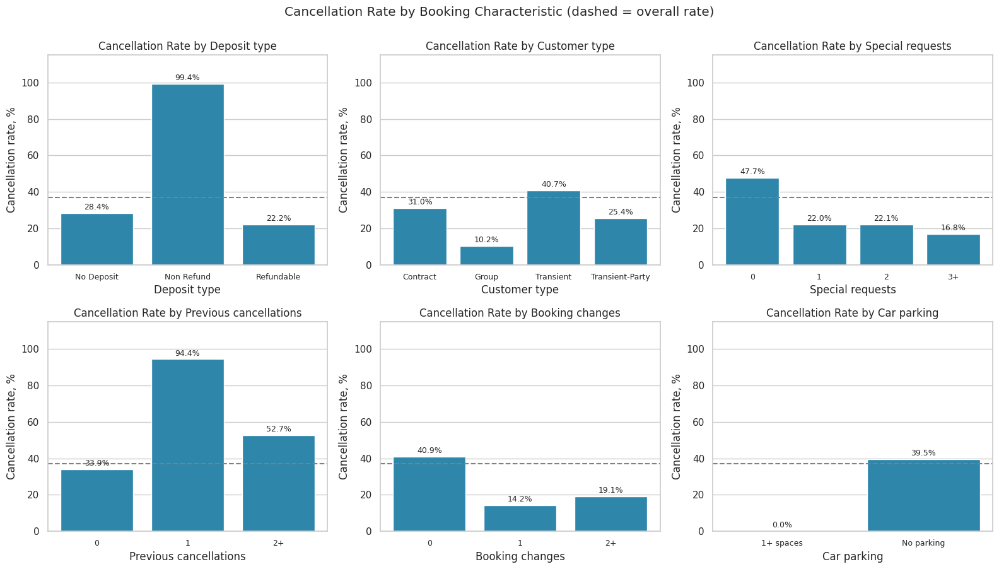

# Chart Gallery and Analysis

This folder contains all 9 charts produced by [`hotel_bookings.ipynb`](../hotel_bookings.ipynb), exported as PNG files. Each chart below has a direct file link, an explanation of how to read it, what it shows, and what to be careful about.

**Data:** 119,390 hotel bookings, arrivals from 2015-07-01 to 2017-08-31, two hotels (`City Hotel`, `Resort Hotel`). Overall cancellation rate: **37.0%** (`is_canceled = 1`, which includes 1,207 no-shows).

## Chart index

| # | Chart | File | Notebook section | Main question |
|---|---|---|---|---|
| 1 | [Booking heatmap - raw counts](#1-booking-heatmap---raw-counts) | [`01_booking_heatmap_raw.png`](01_booking_heatmap_raw.png) | 2.2 | Which months are busiest? |
| 2 | [Booking heatmaps - corrected for coverage](#2-booking-heatmaps---corrected-for-uneven-coverage) | [`02_booking_heatmap_corrected.png`](02_booking_heatmap_corrected.png) | 2.2 | Is the raw peak real? |
| 3 | [Monthly cancellation rate by hotel](#3-monthly-cancellation-rate-by-hotel) | [`03_monthly_cancellation_rate.png`](03_monthly_cancellation_rate.png) | 2.3 | When do guests cancel? |
| 4 | [Lead time analysis](#4-lead-time-analysis) | [`04_lead_time_analysis.png`](04_lead_time_analysis.png) | 2.4 | Do early bookings cancel more? |
| 5 | [Top 10 countries](#5-top-10-countries) | [`05_top10_countries.png`](05_top10_countries.png) | 2.5 | Where do guests come from, and who cancels? |
| 6 | [Market segments](#6-market-segments) | [`06_market_segments.png`](06_market_segments.png) | 2.6 | Which channels bring volume and risk? |
| 7 | [ADR by month and hotel (dual axis)](#7-adr-by-month-and-hotel-dual-axis) | [`07_adr_dual_axis.png`](07_adr_dual_axis.png) | 2.7 | How do prices move through the year? |
| 8 | [Revenue exposure from cancellations](#8-revenue-exposure-from-cancellations) | [`08_revenue_exposure.png`](08_revenue_exposure.png) | 2.8 | How much potential revenue sits in cancelled bookings? |
| 9 | [Cancellation drivers](#9-cancellation-drivers) | [`09_cancellation_drivers.png`](09_cancellation_drivers.png) | 2.9 | Which booking features go with cancellation? |

> **Reading note:** every chart shows *associations*. None of them proves that changing one variable would change cancellations.

---

## 1. Booking heatmap - raw counts

[Open file: `01_booking_heatmap_raw.png`](01_booking_heatmap_raw.png)

**What it shows:** a pivot table (rows = arrival month, columns = hotel, values = number of bookings) drawn as a heatmap. Darker blue means more bookings.

**How to read it:** compare colours down a column to see seasonality inside one hotel, and across a row to compare the two hotels in the same month.

**Analysis**

- `City Hotel` has more bookings than `Resort Hotel` in **all 12 months**.
- On raw counts **August is the peak (13,877 bookings: City 8,983, Resort 4,894)** and **January the lowest (5,929)**.
- Resort's share of bookings is 35.3% in August and 36.1% in July, but also **39.1% in December** and only **27.8% in June**. This is a share pattern, not a summer takeover.

**Caution:** the data covers July 2015 - August 2017, so July and August appear **three times** and every other month only **twice**. Raw counts therefore overstate those two months. Chart 2 corrects this.

---

## 2. Booking heatmaps - corrected for uneven coverage

[Open file: `02_booking_heatmap_corrected.png`](02_booking_heatmap_corrected.png)

**What it shows:** two corrected views of the same pivot. **Left:** average bookings per observed year (raw count divided by the number of years each month appears). **Right:** 2016 only, the only complete calendar year.

**Analysis**

- Per observed year the busiest month is **May (5,896 bookings)**; August falls to **7th place (about 4,625)**.
- In 2016 the busiest month is **October (6,203 bookings: City 4,219, Resort 1,984)**; August is only **6th (5,063)**.
- **January is the weakest month in every view** (2016: City 1,364, Resort 884).
- `City Hotel` stays strong in April-June and September-October (3,561-4,219 in 2016). `Resort Hotel` dips in June-July (1,369-1,441) compared with March-May and October (1,778-1,984).

**Caution:** the left view is itself pulled down for July-August by the low-volume 2015 launch period (about 3,666 bookings per month in 2015 vs about 4,726 in 2016), so the right-hand 2016 view is the cleaner baseline. These are bookings by arrival month, not occupancy; the dataset has no room capacity.

---

## 3. Monthly cancellation rate by hotel

[Open file: `03_monthly_cancellation_rate.png`](03_monthly_cancellation_rate.png)

**What it shows:** the share of bookings cancelled, by arrival month, for each hotel. Dashed horizontal lines are each hotel's yearly average (City 41.7%, Resort 27.8%).

**Analysis**

- `City Hotel` cancels more than `Resort Hotel` in **every month**; the gap ranges from **6.6 pp (August)** to **24.8 pp (January)**.
- **City Hotel:** lowest in March (**36.9%**), highest in April (**46.3%**) - a spread of only 9.4 pp. Cancellation is high all year.
- **Resort Hotel:** lowest in January (**14.8%**), highest in August (**33.4%**) - a spread of 18.6 pp. June-September stay at 31.4-33.4%.
- For `City Hotel`, months with more demand also have more cancellations (Spearman rho = 0.65, p = 0.022, n = 12); for `Resort Hotel` the link is weak (rho = 0.38, p = 0.217).

**Caution:** 12 monthly points make the correlation a hint, not proof, and correlation is not causation. Rates are ratios, so they are not distorted by the uneven month coverage, but the year mix still differs by month.

---

## 4. Lead time analysis

[Open file: `04_lead_time_analysis.png`](04_lead_time_analysis.png)

**What it shows:** **Left:** box plots of lead time (days between booking and arrival) for kept vs cancelled bookings, per hotel (outliers hidden). **Right:** cancellation rate by lead-time bucket, for all bookings and for bookings *excluding* `Non Refund` deposits.

**Analysis**

- Cancelled bookings are made much earlier: median **113 days vs 45** for kept bookings (`City Hotel` 115 vs 50, `Resort Hotel` 109 vs 38). The Mann-Whitney test is significant in every group (p < 0.001); a random cancelled booking has a longer lead time than a random kept one in **69%** of pairs.
- The all-bookings curve climbs steadily: **9.6%** (0-7 days), 27.9%, 37.7%, 44.7%, 55.5% (181-365 days), **67.7%** (365+ days).
- **Excluding `Non Refund` deposits the curve is flatter:** 9.2% -> 26.0% -> 32.2% -> 34.8% -> **39.8%** (181-365 days), and the 365+ bucket **falls to 20.7%**.

**Takeaway:** long lead time is a genuine risk signal for flexible bookings, but the extreme 67.7% at 365+ days comes from non-refundable group bookings, not from lead time itself.

**Caution:** the data shows *whether* a booking was cancelled, not *when*. Lead time alone cannot size an overbooking buffer.

---

## 5. Top 10 countries

[Open file: `05_top10_countries.png`](05_top10_countries.png)

**What it shows:** **Left:** total bookings of the 10 largest source countries. **Right:** cancellation rate of the same countries; the dashed line is the 37.0% overall rate.

**Analysis**

- The Top 10 countries cover **84.4%** of bookings. **`PRT` (Portugal) alone is 48,590 bookings (40.7%)**, far ahead of GBR (12,129) and FRA (10,415).
- `PRT` cancels at **56.6%**. ITA (35.4%) and BRA (37.3%) are close to the overall rate; GBR 20.2%, FRA 18.6%, ESP 25.4%, DEU 16.7%, IRL 24.7%, BEL 20.2% and NLD 18.4% are well below it.
- **The `PRT` figure is largely a deposit effect.** `Non Refund` bookings are 12.2% of all bookings, 97.2% of them come from `PRT`, and 99.4% of them are cancelled. `PRT` bookings with `No Deposit` cancel at 38.9% - still above the 23.2% of other countries, so the country gap is real but much smaller than the headline suggests.

**Caution:** country codes are ISO alpha-3. 488 rows with a missing country were set to `'Unknown'`.

---

## 6. Market segments

[Open file: `06_market_segments.png`](06_market_segments.png)

**What it shows:** **Left:** pie chart of booking share by market segment (`Complementary`, `Aviation` and `Undefined` are grouped as "Other"). **Right:** cancellation rate per segment with booking counts; the dashed line is the 37.0% overall rate.

**Analysis**

- **`Online TA` is 47.3% of bookings and 46.9% of all cancellations** (rate 36.7%). `Offline TA/TO` is 20.3% (34.3%), `Groups` 16.6%, `Direct` 10.6%, `Corporate` 4.4%.
- **`Groups` cancel at the highest rate (61.1%).** Excluding `Non Refund` deposits this drops to **28.1%**; `Offline TA/TO` drops from 34.3% to 17.2% and `Corporate` from 18.7% to 13.7%, while **`Online TA` stays at 36.7%**.
- **`Direct` has the lowest rate among segments with at least 1,000 bookings (15.3%)** and earns almost the same average ADR on kept bookings as `Online TA` (116.2 vs 115.0).
- `Complementary` is lower (13.1%) but has only 743 bookings and a very low ADR (free stays), so it is not a comparable commercial segment. `Transient` customers make up 75.1% of bookings.

**Caution:** Direct guests may differ from OTA guests in ways the data cannot show, so the gap is an association.

---

## 7. ADR by month and hotel (dual axis)

[Open file: `07_adr_dual_axis.png`](07_adr_dual_axis.png)

**What it shows:** grey bars (left axis) are kept (not cancelled) bookings by arrival month in 2016. Lines (right axis) are the average daily rate (ADR) of kept bookings for each hotel, using all years.

**Analysis**

- **Resort ADR swings 3.7x:** from **50 (November)** to **184 (August)**; July is 153 and June 110.
- **City ADR is flat:** between **84 (January)** and **123 (May)** - only 1.5x. From April to September it stays at 114-123.
- Resort's summer premium appears only in **July and August**; in June Resort ADR (110) is still below City (120).
- So Resort wins in summer on **price, not on volume**: its 2016 bookings in June-July are below its spring and October levels.

**Caution:** ADR is a plain average across room types and meal plans; mix is not controlled. Bookings with `adr <= 0` or `adr >= 1,000` are excluded (1,747 kept bookings). The two axes have different units, so compare shapes, not heights.

---

## 8. Revenue exposure from cancellations

[Open file: `08_revenue_exposure.png`](08_revenue_exposure.png)

**What it shows:** a room-revenue proxy (`adr` x nights, in millions of the dataset's currency units) per hotel, split into kept bookings, cancelled `Non Refund` bookings and cancelled flexible-deposit bookings.

**Analysis**

- **43.0% of potential room revenue at `City Hotel`** (10.9M of 25.3M) and **33.5% at `Resort Hotel`** (5.8M of 17.4M) sits in cancelled bookings.
- Of the cancelled revenue, `Non Refund` bookings account for about 3.2M at City but only 0.4M at Resort.
- If `Non Refund` deposits are retained by the hotel, the truly exposed revenue is the flexible-deposit part: **about 30.5% at City and 31.0% at Resort - almost identical.** The headline gap between the hotels (41.7% vs 27.8%) is therefore mostly a `Non Refund` effect, not a difference in guest behaviour.

**Caution:** this is a proxy, not booked revenue. The data does not say whether deposits were collected or kept, so the chart gives a range, not a loss figure.

---

## 9. Cancellation drivers

[Open file: `09_cancellation_drivers.png`](09_cancellation_drivers.png)

**What it shows:** six small bar charts of the cancellation rate by deposit type, customer type, number of special requests, previous cancellations, booking changes and car parking. The dashed line is the 37.0% overall rate.

**Analysis**

- **Deposit type is by far the strongest marker:** `Non Refund` **99.4%**, `No Deposit` 28.4%, `Refundable` 22.2% (162 bookings). Cramer's V = 0.48 (large), vs 0.27 for market segment and about 0.14 for hotel and customer type.
- `Transient` customers cancel at 40.7%, `Transient-Party` 25.4%, `Contract` 31.0%, `Group` 10.2% (577 bookings).
- Bookings with **no special request cancel at 47.7%** vs 21.7% with at least one; **no booking changes: 40.9%** vs 14.2% with one change.
- **`previous_cancellations = 1` shows 94.4%** - but 95.7% of those bookings are `PRT` and 58.4% are `Non Refund`, so it is the same cluster seen again, not an independent signal.

**Caution:** special requests, booking changes and car parking (0.0% cancellation with 1+ spaces) can be recorded after the booking and only for stays that continue, so they follow the outcome. Treat them as indicators, not levers.

